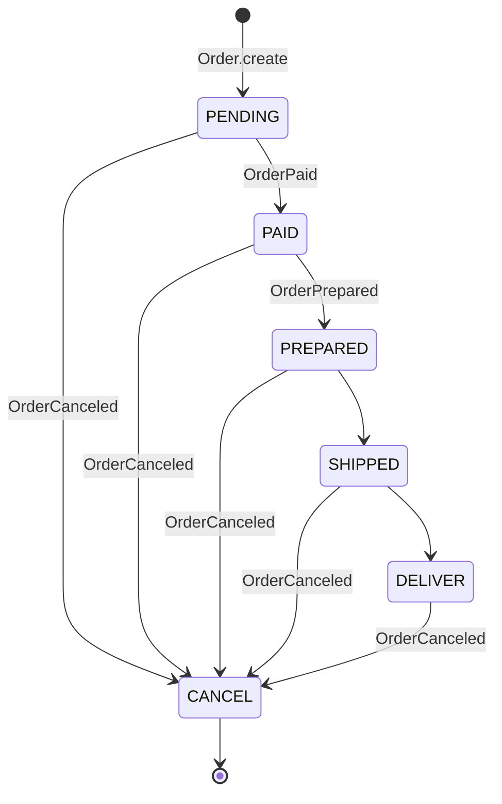
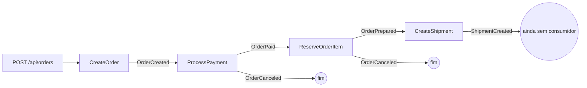

# Checkout System

Sistema de checkout desenvolvido em **Java e Spring Boot**, com o objetivo de explorar conceitos de arquitetura de
software, Domain-Driven Design (DDD), processamento de pedidos e comunicação assíncrona baseada em eventos.

O projeto busca aplicar padrões e práticas utilizados em sistemas distribuídos e arquiteturas orientadas a eventos,
mantendo uma separação clara entre domínio, aplicação e infraestrutura.

## Tecnologias

- **Java / Spring Boot** — desenvolvimento da aplicação.
- **Spring Data JPA / Hibernate** — persistência de dados.
- **PostgreSQL** — banco de dados relacional.
- **Flyway** — gerenciamento de migrações.
- **Apache Kafka** — mensageria e comunicação assíncrona.

## Arquitetura

O projeto segue uma abordagem de arquitetura em camadas, com separação de responsabilidades:

- **API:** exposição dos endpoints e tratamento das requisições.
- **Application:** implementação dos casos de uso e orquestração dos fluxos.
- **Domain:** regras de negócio, entidades e conceitos do domínio.
- **Infrastructure:** implementações de persistência, mensageria e integrações externas.

A persistência é isolada do domínio, utilizando modelos específicos para o mapeamento com JPA.

## Conceitos explorados

- **Domain-Driven Design (DDD):** modelagem do domínio através de entidades, agregados e regras de negócio.
- **Event-Driven Architecture:** comunicação entre componentes através de eventos.
- **Publish/Subscribe:** abstração para publicação e consumo de eventos, independente da implementação de mensageria.
- **Transactional Outbox:** estratégia para garantir a consistência entre transações de banco de dados e publicação de
  eventos.
- **Dependency Injection:** inversão de dependências e desacoplamento entre implementações.
- **Repository Pattern:** abstração do acesso e persistência de dados.

## Contextos (bounded contexts)

O código é organizado por contexto em `com.example.checkout`, cada um dividido em `api` / `application` / `domain` /
`infrastructure`:

- **order:** pedidos, pagamento e ciclo de vida do pedido.
- **inventory:** unidades de produto e reservas de estoque.
- **shipment:** envios (`Shipment`) e rotas (`Route`). A rota é gerada por um `FakeRoutePlanner`, pois o objetivo é
  estudar a arquitetura, não logística real.
- **shared:** erros, contrato de eventos e a infraestrutura de mensageria (`Publisher`, `EventBus`, outbox).

## Modelo de domínio

As entidades de domínio são classes Java puras, sem anotações JPA. A persistência fica em `infrastructure/persistence`,
com modelos `*Model` separados e repositórios que convertem entre o modelo JPA e o domínio.

### Pedido (`Order`)

`Order` é o agregado raiz do contexto `order`:

| Campo | Descrição |
|---|---|
| `id` | Identificador do pedido. |
| `customerId` | Cliente que fez o pedido. |
| `items` | Lista de `OrderItem` (`id` do produto, `quantity`, `price`). |
| `total` | Soma de `quantity * price` de cada item, calculada em `Order.create`. |
| `timeline` | Histórico de status (`OrderTimeline`), detalhado abaixo. |
| `events` | Eventos de domínio registrados pelas mudanças de status, ainda não publicados. |

- **`Order.create(customerId, items)`** cria o pedido em `PENDING` e calcula o total.
- **`status()`** não é um campo: é sempre o último registro do histórico.
- **`changeStatus(novoStatus)`** é a única forma de mudar o status. Ela pergunta ao estado atual se a transição é
  permitida, adiciona o novo status ao histórico e guarda os eventos gerados em `events()`. Quem publica esses
  eventos é o caso de uso, depois de salvar o pedido.

### Histórico de status (`OrderTimeline` / `OrderHistory`)

O status não é sobrescrito: cada mudança vira um novo `OrderHistory` (`id`, `status`, `occurredAt`, `next`), e o
histórico só cresce (*append-only*).

- Os registros formam uma **lista ligada**: cada um aponta (`next`) para o registro seguinte, e o atual é o único
  sem `next`.
- O ponteiro `next` só pode ser definido uma vez; tentar religar um registro gera `DomainError`
  (`STATUS_ALREADY_LINKED`).
- Ao carregar um pedido do banco, `OrderTimeline` valida a corrente: precisa ter ao menos um registro, cada `next`
  precisa apontar para o registro seguinte, e o último precisa ser o atual. Caso contrário, `DomainError`
  (`INVALID_STATUS_HISTORY`). Na infraestrutura, `OrderHistoryChain` ordena as linhas do banco seguindo os ponteiros.
- A consulta de pedidos do cliente devolve esse histórico, permitindo ver quando o pedido passou por cada status.

### Máquina de estados

As transições usam o **padrão State**: `OrderState` é uma interface `sealed` com uma implementação por status
(`PendingState`, `PaidState`, `PreparedState`, `ShippedState`, `DeliveredState`, `CanceledState`). Cada estado sabe
para quais status pode ir e quais eventos a transição gera, devolvendo um `Transition(to, events)`.



| Status atual | Pode ir para | Evento gerado |
|---|---|---|
| `PENDING` | `PAID` | `OrderPaid` |
| `PAID` | `PREPARED` | `OrderPrepared` |
| `PREPARED` | `SHIPPED` | nenhum |
| `SHIPPED` | `DELIVER` | nenhum |
| qualquer um acima e `DELIVER` | `CANCEL` | `OrderCanceled` (com o status anterior) |
| `CANCEL` | nada — estado final | — |

- Uma transição não permitida gera `DomainError` (`INVALID_STATUS`, ou `CANCELED_ORDER` para pedido cancelado). No
  fluxo por eventos, a outbox marca esse evento como `FAILED` sem tentar de novo.
- `SHIPPED` e `DELIVER` já existem na máquina de estados, mas nenhum caso de uso leva o pedido até eles ainda, e
  essas transições não geram eventos.

### Outros agregados

- **`Product` / `Unit` (inventory):** cada `Unit` é uma unidade física de um produto, `AVAILABLE` ou `RESERVED`.
- **`Reservation` (inventory):** liga as unidades reservadas ao pedido (`referenceId`); `Reservation.create` marca as
  unidades como reservadas.
- **`Shipment` / `Route` (shipment):** o envio de um pedido (`orderId`, `routeId`, `trackingCode`, `status`) e a rota
  usada (`vehicle`, `start`, `end`). `Shipment.create` começa em `CREATED` e registra `ShipmentCreated`.

## Fluxo orientado a eventos

Todo o ciclo de vida do pedido é guiado por eventos. Cada caso de uso altera seu agregado, salva e publica os eventos
que o agregado registrou; um *subscriber* em outro ponto do sistema reage e dispara o próximo caso de uso.



| Evento | Publicado por | Consumido por | O que acontece |
|---|---|---|---|
| `OrderCreated` | `CreateOrder` | `OrderCreatedSubscriber` | `ProcessPayment` cobra o pedido: `PAID` ou `CANCEL`. |
| `OrderPaid` | `ProcessPayment` | `OrderPaidSubscriber` | `ReserveOrderItem` reserva o estoque no `inventory`. |
| `OrderPrepared` | `ReserveOrderItem` | `shipment.OrderPreparedSubscriber` | `CreateShipment` cria o envio com rota e código de rastreio. |
| `OrderCanceled` | `ProcessPayment` / `ReserveOrderItem` | — | Pagamento recusado ou estoque indisponível. |
| `ShipmentCreated` | `CreateShipment` | — | Ponto de extensão para os próximos passos do envio. |

Detalhes do fluxo:

- **Eventos nascem no agregado.** `Order.changeStatus` e `Shipment.create` registram os eventos em `events()`; o caso
  de uso só os publica depois de salvar o agregado.
- **Um pedido só vira `PREPARED` depois que a reserva funciona.** Se o estoque falhar, o pedido vai direto para
  `CANCEL` e apenas `OrderCanceled` é publicado — assim nenhum envio é criado para pedido cancelado.
- **Contextos não se conhecem por dentro.** `order` fala com `inventory` por uma porta própria
  (`OrderInventoryService`); `shipment` depende só do evento `OrderPrepared` (apenas o `orderId`).
- Todos os eventos implementam `shared.domain.Event` (`eventId`, `occurredAt`).

## Publisher e EventBus

A mensageria fica atrás de duas abstrações em `shared/infrastructure/queue`, para que os casos de uso não saibam qual
tecnologia está por baixo:

- **`Publisher.publish(event)`** — envia um evento.
- **`EventBus.subscribe(EventClass, handler)`** — registra um handler. Os *subscribers* são `@Component`s que se
  registram no construtor.

A implementação é escolhida por propriedade:

| Propriedade | Valores | Padrão | Em `application.properties` |
|---|---|---|---|
| `app.publisher.provider` | `spring`, `kafka`, `outbox` | `spring` | `outbox` |
| `app.eventBus.provider` | `spring`, `outbox` | `spring` | `outbox` |

- **`spring`:** em memória via `ApplicationEventPublisher` / `@EventListener`, síncrono, no mesmo processo.
- **`outbox`:** Transactional Outbox no Postgres (detalhado abaixo).
- **`kafka`:** `KafkaPublisher` envia para um tópico com o nome simples da classe do evento. Ainda não há consumidor
  Kafka nem serviço Kafka no `docker-compose`.

## Transactional Outbox

**Publicação (`OutboxPublisher`):** em vez de enviar o evento para fora, grava uma linha na tabela `outbox_events` com
o `eventId`, o tipo (nome simples da classe), o payload em JSON e status `PENDING`.

**Consumo (`OutboxEventBus`):** um poller `@Scheduled` que, a cada intervalo:

1. Abre uma transação e trava **uma** linha `PENDING` com `FOR UPDATE SKIP LOCKED` — várias instâncias podem rodar o
   poller sem processar a mesma linha.
2. Reconstrói o evento a partir do tipo + JSON e executa os subscribers **na mesma transação**.
3. Marca a linha como `PROCESSED` e faz commit. Como os subscribers rodam dentro dessa transação, as alterações que
   fazem e os novos eventos que gravam na outbox são confirmados junto com o ack: ou tudo acontece, ou nada.
4. Repete até `batch-size` linhas ou até não haver mais pendentes.

**Falhas:** a transação sofre rollback (descartando o trabalho parcial) e a falha é registrada em outra transação:

- Erros técnicos são tentados de novo com *backoff* exponencial (1s, 2s, 4s, 8s…) via `next_attempt_at`, até
  `max-attempts`; depois disso a linha fica `FAILED`.
- `DomainError` / `ApplicationError` vão direto para `FAILED`: são regras de negócio, e repetir daria o mesmo erro.

| Variável de ambiente | Propriedade | Padrão |
|---|---|---|
| `OUTBOX_POLL_INTERVAL_MS` | `app.outbox.poll-interval-ms` | `5000` |
| `OUTBOX_BATCH_SIZE` | `app.outbox.batch-size` | `100` |
| `OUTBOX_MAX_ATTEMPTS` | `app.outbox.max-attempts` | `10` |

**Transações nos casos de uso:** os casos de uso são `@Transactional`. Em `CreateOrder`, chamado direto pela API,
salvar o pedido e gravar `OrderCreated` na outbox acontecem na mesma transação: se a gravação do evento falhar, o
pedido também não é salvo. Dentro do poller, os casos de uso entram na transação já aberta por ele.
`ReserveProduct` usa `noRollbackFor` para erros de negócio, porque `ReserveOrderItem` captura esses erros e cancela o
pedido na mesma transação.

## Idempotência

A outbox garante entrega **pelo menos uma vez** (*at-least-once*): com retentativas, o mesmo evento pode ser
processado mais de uma vez. Por isso os consumidores precisam ser idempotentes:

- **Pagamento:** `FakeSuccessPaymentProcessor` usa uma chave `customerId:orderId:total` em um `Cache`. Uma segunda
  cobrança retorna `ALREADY_PROCESSED` e `ProcessPayment` não altera o pedido nem publica eventos. O cache atual
  (`MapCache`) é em memória, então a proteção não sobrevive a um reinício.
- **Envio:** `CreateShipment` procura um envio para o `orderId` antes de criar; se existir, devolve o mesmo envio sem
  gerar nova rota nem republicar `ShipmentCreated`. No banco, a constraint única em `shipments.order_id` protege contra
  dois processamentos simultâneos: o segundo falha ao salvar, é tentado de novo pela outbox e então encontra o envio
  existente.
- **Transições de status:** o pedido segue uma máquina de estados (`order/domain/state`); uma transição inválida gera
  `DomainError`, que a outbox marca como `FAILED` sem repetir.

## Executando

```bash
docker compose up -d       # Postgres 18 em localhost:5432 (db/usuário/senha: checkout)
./mvnw spring-boot:run     # aplicação em :8080
./mvnw test                # testes (os @SpringBootTest precisam do Postgres rodando)
```
